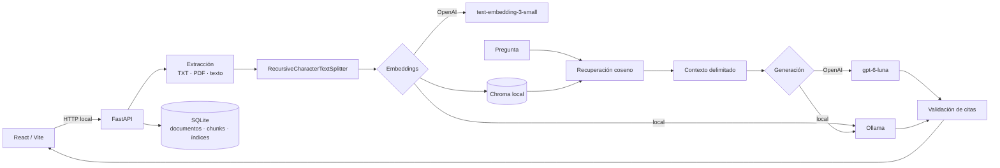

# RAG Lab: POC educativa local

Una aplicación para observar y aprender un flujo RAG completo sin esconderlo detrás de una cadena: extrae texto, crea fragmentos, genera embeddings, persiste vectores, recupera evidencia y responde con citas verificadas.

## Qué incluye

- React, TypeScript y Vite en el frontend.
- FastAPI, Python 3.12 y SQLite en el backend.
- LangChain con sus integraciones oficiales para OpenAI, Ollama y Chroma.
- Chroma persistente, ejecutado dentro del proceso local; no hay servicio administrado.
- Texto pegado, TXT UTF-8 y PDF con texto seleccionable. No hay OCR.
- Proveedores de embeddings y generación configurables por separado.
- Vista del texto, chunks, muestra vectorial, resultados, distancias, payload exacto enviado al LLM, respuesta, citas y tokens.
- Presentación independiente **Aprender RAG** con nueve secciones jerárquicas, diagramas, simulaciones locales y un laboratorio opcional de embeddings reales.
- Sin autenticación, Docker, almacenamiento cloud ni fallback automático entre proveedores.

## Arquitectura

El repositorio utiliza un **monolito modular por funcionalidades**. En el backend, cada módulo contiene su router HTTP, esquemas de frontera y servicio de aplicación; SQLite, Chroma y los proveedores son adaptadores de infraestructura. En el frontend, las rutas son composición y cada funcionalidad conserva sus componentes, estado y llamadas de API. Los identificadores del código están en inglés y el contenido educativo permanece en español.



`data/rag.sqlite3` contiene el catálogo visible y `data/chroma/` los vectores. Ambos están ignorados por Git.

```text
backend/app/
├── main.py                 # Fábrica y configuración de FastAPI
├── api/router.py           # Composición de rutas /api/v1
├── core/                   # Configuración, contenedor y errores comunes
├── features/
│   ├── status/             # Disponibilidad de proveedores y almacenamiento
│   ├── documents/          # Ingesta, extracción y fragmentación
│   ├── indexing/           # Huellas, manifiestos e indexación en Chroma
│   ├── query/              # Recuperación, contexto, generación y citas
│   └── learning/           # Laboratorio educativo de embeddings
├── providers/              # Puertos y adaptadores de OpenAI y Ollama
└── infrastructure/
    ├── sqlite/             # Catálogo de documentos, chunks e índices
    └── chroma/             # Persistencia y búsqueda vectorial

frontend/src/
├── app/                    # Aplicación, providers y router
├── routes/                 # Composición de páginas, sin lógica de negocio
├── features/
│   ├── provider-config/    # Selección independiente de proveedores
│   ├── documents/          # Entrada, archivos y fragmentación
│   ├── indexing/           # Creación y selección de índices
│   ├── retrieval/          # Consulta y resultados recuperados
│   ├── generation/         # Payload al LLM, respuesta y citas
│   ├── library/            # Administración de documentos e índices
│   ├── laboratory/         # Estado preservado del flujo completo
│   └── learning/           # Presentación y diapositivas educativas
└── shared/                 # Cliente HTTP, contratos, estilos y UI reutilizable
```

Dentro de una funcionalidad del backend, `router.py` adapta HTTP, `schemas.py`
define los contratos Pydantic, `models.py` contiene modelos internos tipados y
`service.py` ejecuta los casos de uso. Los routers no acceden directamente a
SQLite, Chroma ni a los SDK de los proveedores.

En el frontend, cada funcionalidad es propietaria de sus componentes, hooks,
tipos y estilos. `shared/` contiene únicamente piezas reutilizables y el cliente
HTTP; el estado remoto pertenece a TanStack Query y el progreso temporal del
laboratorio al contexto con reducer.

FastAPI expone exclusivamente la versión `/api/v1`. Los routers son controladores delgados; la lógica vive en servicios tipados. React Router usa las URLs `/laboratorio` y `/aprender`, TanStack Query administra el estado remoto y un contexto con reducer conserva el trabajo del laboratorio entre ambas vistas.

## Requisitos

- Git.
- Python 3.12. El paquete admite Python 3.12 y 3.13, pero `3.12` es la versión de referencia en `.python-version`.
- Node.js 24 y npm. La versión de referencia está en `.nvmrc`.
- `make` es opcional y simplifica los comandos en macOS y Linux.
- Para completar indexación y generación: una clave de OpenAI **o** una instalación local de Ollama con modelos descargados. Sin proveedor, la aplicación igualmente arranca y permite recorrer la presentación, cargar, extraer y fragmentar documentos.

No necesitas un Mac con Apple Silicon. El flujo OpenAI funciona en macOS, Linux y Windows. Los requisitos de memoria y espacio dependen del modelo elegido si usas Ollama.

## Instalación

Después de clonar el repositorio, entra en su carpeta y ejecuta los comandos desde la raíz.

### Instalación rápida en macOS o Linux

```bash
# Opcional, si usas nvm:
nvm use

make install
cp .env.example .env
```

`make install` crea `.venv`, instala el backend con sus dependencias de prueba y ejecuta `npm ci` usando el `package-lock.json` versionado.

### Instalación manual en macOS o Linux

Usa esta alternativa si no tienes `make`:

```bash
python3.12 -m venv .venv
.venv/bin/python -m pip install --upgrade pip
.venv/bin/python -m pip install -e './backend[test]'
cd frontend
npm ci
cd ..
cp .env.example .env
```

### Instalación manual en Windows PowerShell

```powershell
py -3.12 -m venv .venv
.\.venv\Scripts\python.exe -m pip install --upgrade pip
.\.venv\Scripts\python.exe -m pip install -e ".\backend[test]"
Set-Location frontend
npm ci
Set-Location ..
Copy-Item .env.example .env
```

El archivo `.env` es local y está ignorado por Git. Nunca pongas claves reales en `.env.example`.

## Arranque

Para ejecutar cada servidor en una terminal distinta:

```bash
make backend
```

```bash
make frontend
```

Sin `make`, inicia el backend desde la raíz:

```bash
# macOS o Linux
.venv/bin/python -m uvicorn app.main:app --app-dir backend --reload --port 8000
```

```powershell
# Windows PowerShell
.\.venv\Scripts\python.exe -m uvicorn app.main:app --app-dir backend --reload --port 8000
```

Y el frontend en otra terminal, en cualquier sistema:

```bash
cd frontend
npm run dev
```

Abre [http://localhost:5173/laboratorio](http://localhost:5173/laboratorio). La documentación interactiva de la API queda en [http://localhost:8000/docs](http://localhost:8000/docs).

Vite reenvía las rutas `/api` a `http://localhost:8000`. Si cambias los puertos, actualiza `frontend/vite.config.ts` y `FRONTEND_ORIGIN` según corresponda.

En un despliegue de producción, configura el servidor web para devolver `index.html` al solicitar `/laboratorio`, `/aprender` o cualquier ruta de la SPA que no corresponda a un archivo estático.

## Configuración

Las variables disponibles están documentadas en `.env.example`:

| Variable | Propósito | Valor inicial |
| --- | --- | --- |
| `OPENAI_API_KEY` | Credencial leída exclusivamente por FastAPI | vacío |
| `OPENAI_GENERATION_MODEL` | Modelo generador de OpenAI | `gpt-6-luna` |
| `OPENAI_EMBEDDING_MODEL` | Modelo de embeddings de OpenAI | `text-embedding-3-small` |
| `OLLAMA_BASE_URL` | URL del servicio local de Ollama | `http://localhost:11434` |
| `OLLAMA_GENERATION_MODEL` | Modelo generador local | `qwen3:8b` |
| `OLLAMA_EMBEDDING_MODEL` | Modelo local de embeddings | `qwen3-embedding:0.6b` |
| `RAG_DATA_DIR` | Carpeta de SQLite y Chroma | `./data` |
| `RAG_MAX_UPLOAD_MB` | Tamaño máximo de archivos | `15` |
| `FRONTEND_ORIGIN` | Origen permitido por CORS | `http://localhost:5173` |

Si configuras una ruta relativa en `RAG_DATA_DIR`, se interpreta desde el directorio donde arrancas el backend. Para evitar ambigüedad al ejecutarlo desde otro lugar, utiliza una ruta absoluta.

## Configurar OpenAI

Edita el archivo `.env` de la raíz:

```dotenv
OPENAI_API_KEY=tu_clave_de_proyecto
OPENAI_GENERATION_MODEL=gpt-6-luna
OPENAI_EMBEDDING_MODEL=text-embedding-3-small
```

No pegues la clave en la interfaz ni uses una variable `VITE_`: Vite expone esas variables al navegador. La aplicación solo comunica al frontend si la clave está configurada; nunca devuelve su valor ni la registra.

La API de OpenAI tiene facturación propia basada en uso y no está incluida en una suscripción de ChatGPT o en el acceso a Codex. La interfaz muestra tokens cuando el proveedor los entrega. Consulta los precios vigentes antes de hacer cargas grandes.

Con OpenAI seleccionado, el texto de chunks y preguntas sale del equipo hacia la API. La interfaz muestra un aviso antes de usarlo. Las solicitudes de generación usan Responses API con almacenamiento desactivado desde la aplicación (`store=False`).

Si no hay clave, la aplicación arranca, permite extraer y fragmentar documentos y explica qué falta cuando intentas vectorizar o generar con OpenAI.

## Configurar Ollama — requiere una decisión previa

Ollama no se instala ni descarga modelos automáticamente. Como referencia, en un equipo con 24 GB de memoria se pueden considerar:

| Uso | Modelo | Descarga aproximada |
| --- | --- | ---: |
| Generación equilibrada | `qwen3:8b` | 5.2 GB |
| Generación de mayor calidad | `qwen3:14b` | 9.3 GB |
| Embeddings rápidos | `qwen3-embedding:0.6b` | 639 MB |
| Embeddings de mayor calidad | `qwen3-embedding:4b` | 2.5 GB |

Comprueba el tamaño publicado del modelo antes de descargarlo. Instala Ollama mediante el método oficial para tu sistema y descarga únicamente los modelos elegidos. En macOS con Homebrew, la instalación puede hacerse así:

```bash
brew install ollama
ollama serve
ollama pull qwen3:8b
ollama pull qwen3-embedding:0.6b
```

Ollama debe responder en `http://localhost:11434`. La aplicación consulta `/api/tags`, muestra los modelos instalados y nunca cambia a OpenAI si Ollama falla.

Los nombres configurados deben coincidir con los modelos realmente disponibles en OpenAI u Ollama. Si eliges otros modelos en la interfaz, no se descargan ni habilitan automáticamente.

## Cómo usar el laboratorio

1. Elige por separado el proveedor y nombre de modelo para embeddings y generación.
2. Pega texto o carga `examples/ecuador.txt`.
3. Revisa “Texto” y pulsa **Fragmentar**.
4. Inspecciona IDs y páginas; ajusta tamaño y solapamiento si quieres comparar.
5. Pulsa **Vectorizar**. Esto sí usa el proveedor de embeddings.
6. Escribe una pregunta y usa **Solo recuperar** para estudiar las distancias sin gastar generación.
7. Abre **Envío LLM**: verás el recorrido, las reglas `system`, la pregunta, las fuentes `<source>` y el mensaje `user` exacto. En este punto aparece **Preparado para enviar** y aún no se ha consumido generación.
8. Pulsa **Preguntar**, vuelve a **Envío LLM** y comprueba el estado **Enviado**, el proveedor/modelo, tokens, tiempos e IDs de citas validadas.

### Consultar documentos ya guardados

La sección **Biblioteca local** permite trabajar con datos persistidos sin volver a
pegar texto. Selecciona todos los documentos —o una parte— y pulsa **Crear índice
compartido**. El laboratorio los fragmenta con el mismo `chunk size` y `chunk
overlap`, crea una colección única en Chroma y permite consultar evidencia de
cualquiera de ellos mediante ese índice.

También puedes elegir un índice ya creado en **Consultar un índice existente**.
Esto carga su configuración y habilita directamente la pregunta del panel de la
derecha. Cuando agregas un documento, los índices anteriores no cambian: crea un
índice compartido nuevo para incorporarlo explícitamente.

**Vaciar datos locales** elimina todos los documentos, chunks, índices y vectores
de SQLite y Chroma después de una confirmación. Conserva los archivos vacíos de
las bases y tus preferencias de proveedor guardadas en el navegador.

Las distancias coseno son medidas de separación, no probabilidades. Un valor menor suele indicar mayor cercanía para este índice, pero no representa un porcentaje de certeza.

Para una primera comprobación utiliza `examples/ecuador.txt` y pregunta **“¿Cuál es la capital de Ecuador?”**. Después prueba una pregunta que el documento no responda para verificar el mensaje de información insuficiente.

## Presentación “Aprender RAG”

El botón **Aprender RAG** abre `/aprender`, una vista didáctica separada del laboratorio. Explica documento, chunks, embeddings, comparación de vectores, recuperación del texto por ID, Chroma, recuperación, contexto, system prompt, generación token por token, validación de citas y evaluación del sistema mediante un mismo caso técnico.

El contenido narrativo completo está disponible en
[`docs/rag-learning-presentation.md`](docs/rag-learning-presentation.md). El
archivo es autocontenido y está preparado para utilizarse como fuente en
NotebookLM al crear un resumen de audio, una presentación o un video educativo.

La presentación incluye un artículo completo editable para observar cómo cualquier cambio vuelve a dividir el texto, controles locales para comparar tamaños y solapamientos de chunks y una simulación de cómo `top_k` modifica las fuentes del contexto. Todo funciona localmente y sin credenciales salvo la diapositiva **Laboratorio**, que llama a OpenAI únicamente después de pulsar **Generar embeddings reales**. Su ejemplo inicial compara una oración en español con candidatos en español e inglés y permite elegir entre `text-embedding-3-small` y `text-embedding-3-large`. FastAPI envía los textos con el modelo seleccionado, calcula las distancias y devuelve el texto asociado al ID del vecino más cercano; la API key nunca llega al navegador. El laboratorio no guarda datos en Chroma ni modifica documentos o índices persistidos. Usa **Anterior/Siguiente**, el índice lateral o las teclas `←`, `→`, `Home` y `End`; **Volver al laboratorio** conserva el estado de trabajo actual.

## Compatibilidad de índices

Cada colección guarda proveedor, modelo, dimensión, tamaño de chunk y solapamiento. El nombre incluye una huella de esa configuración. En una consulta, el backend exige que proveedor, modelo y dimensión coincidan exactamente; usar la misma dimensión con otro modelo también se rechaza con HTTP 409.

Cambiar únicamente el modelo generador no afecta al índice. Cambiar embeddings requiere crear otro índice. Los nombres de modelos se pueden editar en la interfaz.

## Qué aporta LangChain

- **Fragmentación:** `RecursiveCharacterTextSplitter` conserva el flujo legible y permite comparar tamaño y solapamiento.
- **Embeddings:** `OpenAIEmbeddings` y `OllamaEmbeddings` ofrecen una interfaz común, pero el código elige el proveedor explícitamente.
- **Almacenamiento y recuperación:** `langchain-chroma` añade documentos y ejecuta búsqueda de similitud sobre Chroma persistente.
- **Generación:** `ChatOpenAI` y `ChatOllama` reciben el contexto construido de forma visible.
- **Documentos y mensajes:** los tipos de LangChain transportan contenido y metadatos; no se usa una cadena RAG automática.

La extracción, persistencia del catálogo, construcción del prompt y validación de citas permanecen en código propio para que sean observables.

## Seguridad educativa

El prompt delimita cada chunk con `<source>` y declara que su contenido es dato no confiable. Las instrucciones encontradas dentro de un documento no deben cambiar el rol del sistema. Después de generar, el backend acepta como citas únicamente IDs que pertenecen al conjunto recuperado y reporta referencias inventadas por separado.

Esto reduce riesgos de prompt injection, pero no constituye una defensa completa para producción.

## Datos locales, borrado y privacidad

- `data/rag.sqlite3` guarda documentos, texto extraído, chunks, manifiestos e información necesaria para inspeccionar y borrar.
- `data/chroma/` guarda las colecciones vectoriales persistentes, incluidos los embeddings completos y los datos asociados que Chroma utiliza durante la recuperación.
- Ambos destinos y los uploads están ignorados por Git.
- Los botones de borrado de la interfaz eliminan documentos o índices de manera coordinada. **Vaciar datos locales** elimina todo el contenido persistido de ambas bases.
- El laboratorio didáctico de textos y embeddings no persiste sus vectores en SQLite ni Chroma.

Para reiniciar completamente la POC, detén el backend y elimina el contenido generado dentro de `data/`, conservando `data/.gitkeep`. Si los datos importan, copia primero toda la carpeta `data/` como respaldo.

Con Ollama, documentos y preguntas permanecen en el equipo. Con OpenAI, los textos necesarios para embeddings o generación se envían a la API; la interfaz advierte cuándo sucede. La clave permanece en FastAPI y nunca debe llegar al navegador.

## Pruebas

En macOS o Linux con `make`:

```bash
make test
make build
```

Sin `make`, ejecuta Pytest con el Python del entorno virtual y después las tareas del frontend:

```bash
# macOS o Linux
.venv/bin/python -m pytest backend/tests
cd frontend
npm test
npm run build
```

```powershell
# Windows PowerShell, desde la raíz
.\.venv\Scripts\python.exe -m pytest backend/tests
Set-Location frontend
npm test
npm run build
```

Las pruebas de backend cubren fragmentación, metadatos, compatibilidad, citas, protección del prompt, extracción y un flujo Chroma determinista sin credenciales. Las pruebas del frontend cubren configuración independiente, advertencias de privacidad, etapas del laboratorio, payload enviado al LLM y navegación/conceptos de la presentación didáctica.

Las pruebas reales de OpenAI solo deben considerarse ejecutadas si `OPENAI_API_KEY` existe. Las pruebas reales de Ollama requieren que el servicio y los modelos estén instalados. El proyecto no simula ni afirma esas llamadas.

## API principal

- `GET /api/v1/status`
- `GET /api/v1/documents`, `POST /api/v1/documents/text`, `POST /api/v1/documents/upload`
- `POST /api/v1/documents/{id}/chunks`
- `GET|POST /api/v1/indices`
- `POST /api/v1/retrieve`
- `POST /api/v1/chat`
- `POST /api/v1/learning/embeddings`
- `DELETE /api/v1/documents/{id}`, `DELETE /api/v1/indices/{id}`

Los esquemas completos se pueden inspeccionar en `/docs`.

## Problemas frecuentes

- **El frontend abre pero muestra errores de API:** confirma que FastAPI esté escuchando en el puerto 8000 y revisa [http://localhost:8000/api/v1/status](http://localhost:8000/api/v1/status).
- **OpenAI aparece como no disponible:** verifica que `.env` esté en la raíz, que `OPENAI_API_KEY` tenga valor y reinicia el backend. La disponibilidad del modelo también depende de tu proyecto de API.
- **Ollama aparece desconectado:** ejecuta `ollama serve`, comprueba `http://localhost:11434/api/tags` y descarga exactamente el modelo configurado.
- **La consulta responde HTTP 409:** el proveedor, modelo o dimensión de embeddings no coincide con el índice. Selecciona el índice correcto o vuelve a vectorizar; cambiar solo el generador no exige reindexar.
- **Un PDF no produce texto:** esta POC acepta PDF con texto seleccionable y no incluye OCR. Convierte primero el documento escaneado con una herramienta de OCR.
- **El puerto 5173 u 8000 está ocupado:** detén el proceso que lo usa o cambia la configuración de Vite, Uvicorn y `FRONTEND_ORIGIN` de forma consistente.
