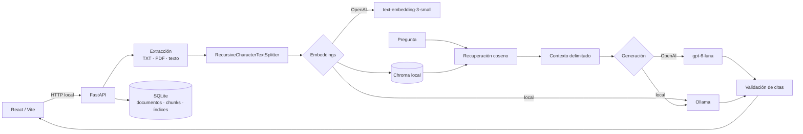

# RAG Lab: POC educativa local

Una aplicación para observar y aprender un flujo RAG completo sin esconderlo detrás de una cadena: extrae texto, crea fragmentos, genera embeddings, persiste vectores, recupera evidencia y responde con citas verificadas.

## Qué incluye

- React, TypeScript y Vite en el frontend.
- FastAPI, Python 3.12 y SQLite en el backend.
- LangChain con sus integraciones oficiales para OpenAI, Ollama y Chroma.
- Chroma persistente, ejecutado dentro del proceso local; no hay servicio administrado.
- Texto pegado, TXT UTF-8 y PDF con texto seleccionable. No hay OCR.
- Proveedores de embeddings y generación configurables por separado.
- Vista del texto, chunks, muestra vectorial, resultados, distancias, payload exacto enviado al LLM, respuesta, citas y tokens.
- Presentación independiente **Aprender RAG** con once conceptos, diagramas, simulaciones locales y un laboratorio opcional de embeddings reales.
- Sin autenticación, Docker, almacenamiento cloud ni fallback automático entre proveedores.

## Arquitectura



`data/rag.sqlite3` contiene el catálogo visible y `data/chroma/` los vectores. Ambos están ignorados por Git.

## Requisitos observados en este Mac

- Apple M4 Pro con 24 GB de memoria.
- Python 3.12 instalado en `/opt/homebrew/bin/python3.12`.
- Node 24 y npm 11 disponibles.
- Ollama no estaba instalado al crear el proyecto.

## Instalación

Desde la raíz del proyecto:

```bash
make install
cp .env.example .env
```

El comando crea `.venv`, instala el backend en modo editable y genera `frontend/package-lock.json`. No copies secretos a `.env.example`.

Para ejecutar cada servidor en una terminal distinta:

```bash
make backend
```

```bash
make frontend
```

Abre [http://localhost:5173](http://localhost:5173). La documentación interactiva de la API queda en [http://localhost:8000/docs](http://localhost:8000/docs).

## Configurar OpenAI

Edita el archivo `.env` de la raíz:

```dotenv
OPENAI_API_KEY=tu_clave_de_proyecto
OPENAI_GENERATION_MODEL=gpt-6-luna
OPENAI_EMBEDDING_MODEL=text-embedding-3-small
```

No pegues la clave en la interfaz ni uses una variable `VITE_`: Vite expone esas variables al navegador. La aplicación solo comunica al frontend si la clave está configurada; nunca devuelve su valor ni la registra.

La API de OpenAI tiene facturación propia basada en uso y no está incluida en una suscripción de ChatGPT o en el acceso a Codex. La interfaz muestra tokens cuando el proveedor los entrega. Consulta los precios vigentes antes de hacer cargas grandes.

Con OpenAI seleccionado, el texto de chunks y preguntas sale del equipo hacia la API. La interfaz muestra un aviso antes de usarlo. Las solicitudes de generación usan Responses API con almacenamiento desactivado desde la aplicación (`store=False`).

Si no hay clave, la aplicación arranca, permite extraer y fragmentar documentos y explica qué falta cuando intentas vectorizar o generar con OpenAI.

## Configurar Ollama — requiere una decisión previa

Ollama no se instaló ni se descargaron modelos automáticamente. Para este M4 Pro de 24 GB se recomiendan:

| Uso | Modelo | Descarga aproximada |
| --- | --- | ---: |
| Generación equilibrada | `qwen3:8b` | 5.2 GB |
| Generación de mayor calidad | `qwen3:14b` | 9.3 GB |
| Embeddings rápidos | `qwen3-embedding:0.6b` | 639 MB |
| Embeddings de mayor calidad | `qwen3-embedding:4b` | 2.5 GB |

Cuando decidas reservar ese espacio, instala Ollama desde su sitio oficial o Homebrew y descarga solo los modelos elegidos:

```bash
brew install ollama
ollama serve
ollama pull qwen3:8b
ollama pull qwen3-embedding:0.6b
```

Ollama debe responder en `http://localhost:11434`. La aplicación consulta `/api/tags`, muestra los modelos instalados y nunca cambia a OpenAI si Ollama falla.

## Cómo usar el laboratorio

1. Elige por separado el proveedor y nombre de modelo para embeddings y generación.
2. Pega texto o carga `examples/ecuador.txt`.
3. Revisa “Texto” y pulsa **Fragmentar**.
4. Inspecciona IDs y páginas; ajusta tamaño y solapamiento si quieres comparar.
5. Pulsa **Vectorizar**. Esto sí usa el proveedor de embeddings.
6. Escribe una pregunta y usa **Solo recuperar** para estudiar las distancias sin gastar generación.
7. Abre **Envío LLM**: verás el recorrido, las reglas `system`, la pregunta, las fuentes `<source>` y el mensaje `user` exacto. En este punto aparece **Preparado para enviar** y aún no se ha consumido generación.
8. Pulsa **Preguntar**, vuelve a **Envío LLM** y comprueba el estado **Enviado**, el proveedor/modelo, tokens, tiempos e IDs de citas validadas.

Las distancias coseno son medidas de separación, no probabilidades. Un valor menor suele indicar mayor cercanía para este índice, pero no representa un porcentaje de certeza.

## Presentación “Aprender RAG”

El botón **Aprender RAG** abre `#aprender`, una vista didáctica separada del laboratorio. Explica documento, chunks, embeddings, comparación de vectores, recuperación del texto por ID, Chroma, recuperación, contexto, system prompt, generación y validación de citas mediante un mismo caso técnico.

La presentación incluye un artículo completo editable para observar cómo cualquier cambio vuelve a dividir el texto, controles locales para comparar tamaños y solapamientos de chunks y una simulación de cómo `top_k` modifica las fuentes del contexto. Todo funciona localmente y sin credenciales salvo la diapositiva **Laboratorio**, que llama a OpenAI únicamente después de pulsar **Generar embeddings reales**. FastAPI envía las palabras, calcula las distancias y devuelve el texto asociado al ID del vecino más cercano; la API key nunca llega al navegador. El laboratorio no guarda datos en Chroma ni modifica documentos o índices persistidos. Usa **Anterior/Siguiente**, el índice lateral o las teclas `←`, `→`, `Home` y `End`; **Volver al laboratorio** conserva el estado de trabajo actual.

## Compatibilidad de índices

Cada colección guarda proveedor, modelo, dimensión, tamaño de chunk y solapamiento. El nombre incluye una huella de esa configuración. En una consulta, el backend exige que proveedor, modelo y dimensión coincidan exactamente; usar la misma dimensión con otro modelo también se rechaza con HTTP 409.

Cambiar únicamente el modelo generador no afecta al índice. Cambiar embeddings requiere crear otro índice. Los nombres de modelos se pueden editar en la interfaz.

## Qué aporta LangChain

- **Fragmentación:** `RecursiveCharacterTextSplitter` conserva el flujo legible y permite comparar tamaño y solapamiento.
- **Embeddings:** `OpenAIEmbeddings` y `OllamaEmbeddings` ofrecen una interfaz común, pero el código elige el proveedor explícitamente.
- **Almacenamiento y recuperación:** `langchain-chroma` añade documentos y ejecuta búsqueda de similitud sobre Chroma persistente.
- **Generación:** `ChatOpenAI` y `ChatOllama` reciben el contexto construido de forma visible.
- **Documentos y mensajes:** los tipos de LangChain transportan contenido y metadatos; no se usa una cadena RAG automática.

La extracción, persistencia del catálogo, construcción del prompt y validación de citas permanecen en código propio para que sean observables.

## Seguridad educativa

El prompt delimita cada chunk con `<source>` y declara que su contenido es dato no confiable. Las instrucciones encontradas dentro de un documento no deben cambiar el rol del sistema. Después de generar, el backend acepta como citas únicamente IDs que pertenecen al conjunto recuperado y reporta referencias inventadas por separado.

Esto reduce riesgos de prompt injection, pero no constituye una defensa completa para producción.

## Pruebas

```bash
make test
make build
```

Las pruebas de backend cubren fragmentación, metadatos, compatibilidad, citas, protección del prompt, extracción y un flujo Chroma determinista sin credenciales. Las pruebas del frontend cubren configuración independiente y el aviso de privacidad.

Las pruebas reales de OpenAI solo deben considerarse ejecutadas si `OPENAI_API_KEY` existe. Las pruebas reales de Ollama requieren que el servicio y los modelos estén instalados. El proyecto no simula ni afirma esas llamadas.

## API principal

- `GET /api/status`
- `GET /api/documents`, `POST /api/documents/text`, `POST /api/documents/upload`
- `POST /api/documents/{id}/chunks`
- `GET|POST /api/indices`
- `POST /api/retrieve`
- `POST /api/chat`
- `DELETE /api/documents/{id}`, `DELETE /api/indices/{id}`

Los esquemas completos se pueden inspeccionar en `/docs`.
